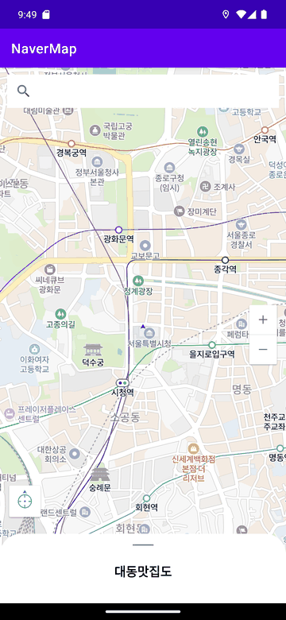
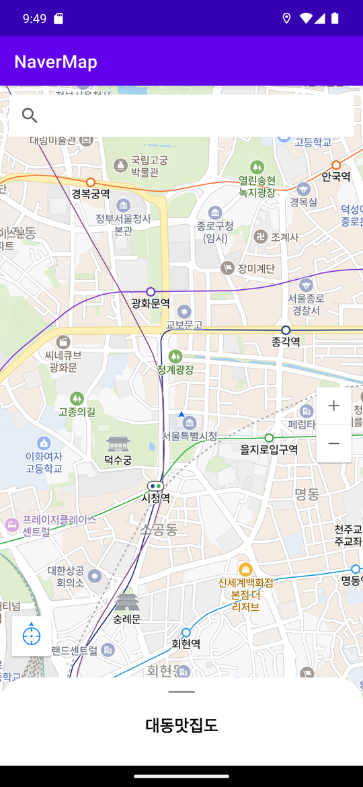
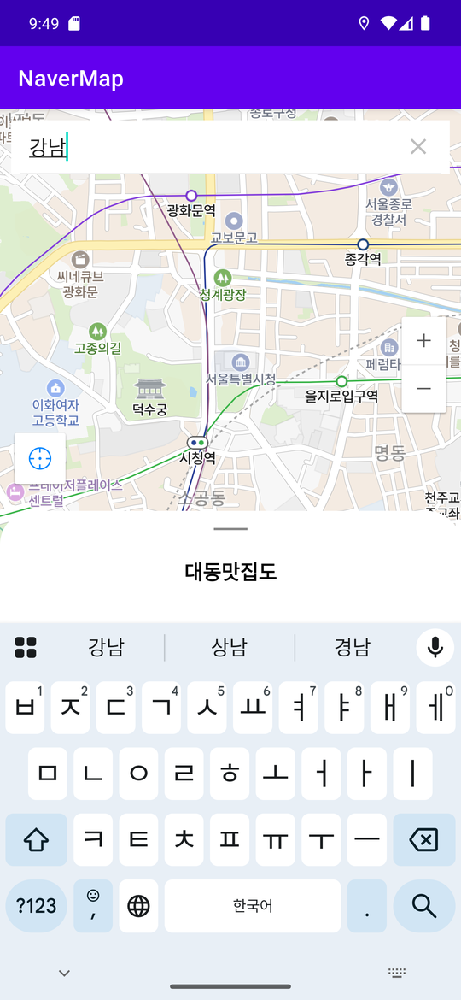
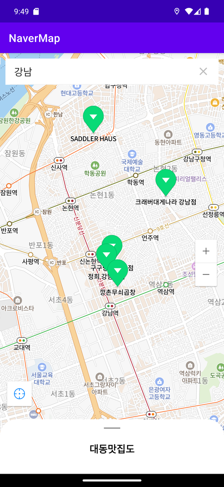
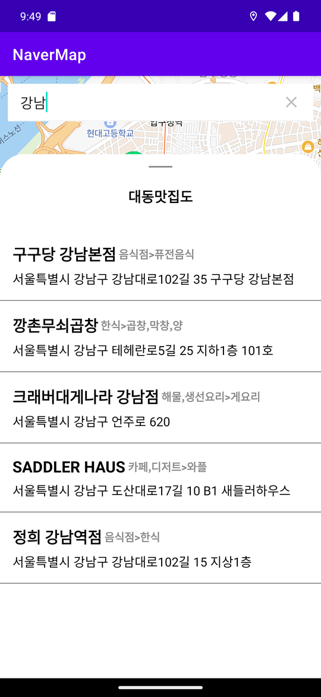
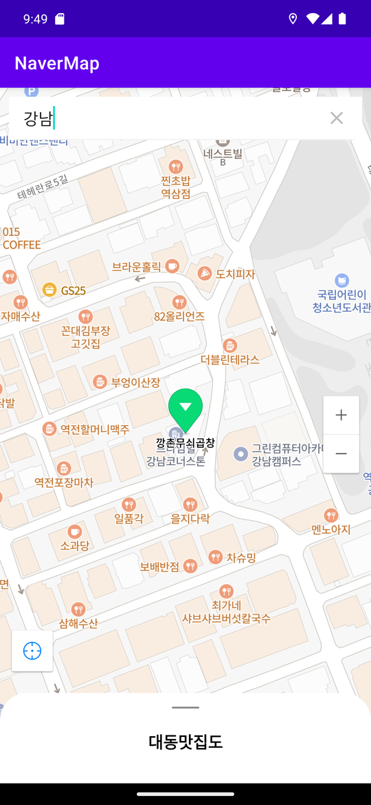

# NaverMap (대동맛집도)

네이버 지도 SDK와 네이버 검색(지역) API를 이용해 **지역명으로 맛집을 검색하고 지도 위에 마커로 보여주는 Android 앱**입니다.
지도 하단의 바텀시트(`대동맛집도`)에 검색 결과 목록이 표시되며, 목록의 항목이나 마커를 누르면 해당 위치로 카메라가 이동합니다.

## 주요 기능

| 기능 | 설명 |
|------|------|
| 네이버 지도 표시 | Naver Maps SDK(`MapView`)로 지도를 표시하고 줌 컨트롤, 현위치 버튼, 나침반을 제공합니다. |
| 맛집 검색 | 상단 `SearchView`에 지역명(예: `강남`)을 입력하면 `"<검색어> 맛집"`으로 네이버 지역 검색 API를 호출합니다(최대 5건). |
| 마커 표시 | 검색 결과마다 마커를 생성하고 가게 이름을 캡션으로 표시합니다. 새 검색 시 기존 마커는 제거됩니다. |
| 결과 목록 | 바텀시트의 `RecyclerView`에 가게 이름, 카테고리, 도로명 주소를 보여줍니다. |
| 카메라 이동 | 검색 직후에는 첫 번째 결과로 이동(줌 13)하고, 목록 항목이나 마커를 선택하면 해당 위치로 확대 이동(줌 17)합니다. |
| 위치 권한 | 실행 시 위치 권한을 요청하고, 허용되면 현위치 추적(`Follow`) 모드로 동작합니다. 권한이 없으면 안내 다이얼로그를 띄우고 앱 설정으로 이동시킵니다. |

## 시연



| 지도 첫 화면 | 검색어 입력 | 검색 결과 마커 |
|:---:|:---:|:---:|
|  |  |  |

| 결과 목록(바텀시트) | 항목 선택 시 카메라 이동 |
|:---:|:---:|
|  |  |

## 실행 화면 흐름

1. 앱 실행 → 서울 시청 일대 지도가 표시되고 하단에 `대동맛집도` 바텀시트가 접힌 상태로 보입니다.
2. 상단 검색창에 지역명 입력 후 검색 → 마커가 찍히고 바텀시트에 결과 목록이 채워집니다.
3. 목록 항목 또는 마커 선택 → 해당 가게 위치로 지도가 확대 이동합니다.

## 기술 스택

- **언어**: Kotlin (ViewBinding 사용)
- **SDK**: minSdk 28 / targetSdk·compileSdk 33
- **지도**: `com.naver.maps:map-sdk:3.17.0`, `FusedLocationSource`(현위치)
- **네트워크**: Retrofit 2.9.0 + OkHttp, Moshi(`converter-moshi`, `moshi-kotlin`)
- **UI**: Material Components(`BottomSheetBehavior`), ConstraintLayout, CoordinatorLayout, RecyclerView
- **빌드**: Gradle (Groovy DSL), Naver Maven 저장소(`https://repository.map.naver.com/archive/maven`)

## 프로젝트 구조

```
app/src/main/java/com/example/navermap/
├── MainActivity.kt          # 지도/검색/바텀시트/권한 처리의 중심 Activity
├── MyApplication.kt         # Application Context 보관 (API 키 조회용)
├── RestarantListAdapter.kt  # 검색 결과 RecyclerView 어댑터
├── SearchRepository.kt      # Retrofit 클라이언트 (인증 헤더 인터셉터 포함)
├── SearchService.kt         # GET v1/search/local.json 정의
└── SearchResult.kt          # 응답 모델 (SearchResult, SearchItem)
app/src/main/res/
├── layout/activity_main.xml     # 지도 + 검색창 + 위젯 + 바텀시트 include
├── layout/bottom_sheet.xml      # 결과 목록 바텀시트
├── layout/item_restarant.xml    # 목록 항목
├── values/api_key_sample.xml    # API 키 샘플 (Git에 포함, 실제 키 없음)
└── values/api_key.xml           # 네이버 API 키 (직접 생성, .gitignore로 Git 제외)
```

## 실행 방법

### 1. 네이버 API 키 발급

[네이버 클라우드 플랫폼](https://www.ncloud.com/)과 [네이버 개발자 센터](https://developers.naver.com/)에서 아래 두 가지를 발급받습니다.

- **Maps SDK(Mobile Dynamic Map)** Client ID — 패키지명 `com.example.navermap`으로 등록
- **검색 API** Client ID / Client Secret — 사용 API에 "검색" 추가

### 2. 키 설정

실제 키가 들어가는 `api_key.xml`은 Git에 올라가지 않으므로(`.gitignore` 등록), 저장소를 받은 뒤 **샘플 파일을 복사해서 직접 만들어야 합니다.**

1. `app/src/main/res/values/api_key_sample.xml`을 같은 폴더에 `api_key.xml`로 복사합니다.

   ```bash
   cp app/src/main/res/values/api_key_sample.xml app/src/main/res/values/api_key.xml
   ```

2. 복사한 `api_key.xml`을 열어 안내 주석 안의 세 줄을 `<resources>` 안으로 옮기고, `YOUR_...` 값을 발급받은 키로 바꿉니다. 완성된 모습은 다음과 같습니다.

   ```xml
   <?xml version="1.0" encoding="utf-8"?>
   <resources>
       <string name="naver_client_id">지도 SDK Client ID</string>
       <string name="naver_search_client_id">검색 API Client ID</string>
       <string name="naver_search_client_secret">검색 API Client Secret</string>
   </resources>
   ```

| 리소스 이름 | 용도 |
|---|---|
| `naver_client_id` | 네이버 지도 SDK 인증 (`AndroidManifest.xml`의 `CLIENT_ID` 메타데이터) |
| `naver_search_client_id` | 검색 API 요청 헤더 `X-Naver-Client-Id` |
| `naver_search_client_secret` | 검색 API 요청 헤더 `X-Naver-Client-Secret` |

> ⚠️ **키 보안 주의**
> - `api_key.xml`은 `.gitignore`에 등록되어 있어 commit되지 않습니다. 실수로 이미 추적 중이라면 `git rm --cached app/src/main/res/values/api_key.xml`로 추적을 해제하세요.
> - 샘플 파일(`api_key_sample.xml`)에는 **실제 키를 넣지 마세요.** 이 파일은 Git에 올라갑니다.
> - 샘플 파일은 `res/values` 안에서 함께 빌드되므로, 주석 안의 `<string>` 줄을 주석 밖에 그대로 두면 `api_key.xml`과 이름이 중복되어 빌드 오류가 납니다.
> - 안드로이드는 `res/values` 안에 `.xml`이 아닌 파일(예: `.key`)이 있으면 빌드가 실패하므로 샘플도 `.xml` 확장자를 사용합니다.

### 3. 빌드 및 설치

`api_key.xml`이 준비된 상태에서 빌드합니다. (없으면 `naver_client_id` 등 리소스를 찾지 못해 빌드가 실패합니다.)

```bash
./gradlew assembleDebug          # Windows: gradlew.bat assembleDebug
adb install -r app/build/outputs/apk/debug/app-debug.apk
```

또는 Android Studio에서 프로젝트를 열고 `app` 모듈을 실행하면 됩니다. 인터넷 연결이 필요합니다.

## 테스트 기록

Android 에뮬레이터(API 33 이상)에서 직접 빌드·설치해 확인했습니다.

- ✅ `assembleDebug` 빌드 성공
- ✅ 앱 실행 및 네이버 지도 타일 정상 표시(서울 시청 일대), 줌 컨트롤·현위치 버튼·바텀시트 표시
- ✅ 검색창 입력(`강남`) 및 검색 요청 발생
- ✅ 검색 API를 직접 호출했을 때 HTTP 200과 맛집 목록(`title`, `category`, `roadAddress`, `mapx`, `mapy`)이 반환됨
- ✅ 앱에서 `강남` 검색 시 마커 5개와 결과 목록(가게명/카테고리/도로명 주소)이 표시됨
- ✅ 목록 항목 선택 시 해당 가게 위치로 카메라가 확대 이동함
- ✅ 지도 SDK 키와 검색 API 키 모두 유효 (잘못된 시크릿은 HTTP 401로 거부됨)
- ⚠️ 앱 실행 직후 첫 검색은 에뮬레이터 네트워크 상태에 따라 `timeout`이 날 수 있으며, 다시 검색하면 정상 동작합니다.
- ✅ 검색 결과 `title`의 `<b>…</b>` 등 HTML 태그와 `&amp;` 같은 엔티티는 `SearchItem.plainTitle`에서 제거/변환되어 목록과 마커 캡션에 깨끗하게 표시됩니다.

## 알려진 한계 / 개선 아이디어

- 네트워크 실패 시 `println`만 하고 사용자에게 안내하지 않습니다(`onFailure`). 토스트 등 안내가 필요합니다.
- 검색 결과는 최대 5건(`display = 5`)이며 페이징이 없습니다.
- 좌표 변환을 `mapx/mapy * 1e-7`로 처리하며(`Tm128` 변환은 주석 처리됨), 응답 형식이 바뀌면 위치가 어긋날 수 있습니다.
- 클래스/파일명 `Restarant`는 `Restaurant`의 오타입니다.
- `play-services-maps` 의존성이 포함되어 있으나 코드에서 사용하지 않습니다.
- 위치 권한 처리 로직(`onResume`의 `lifecycleState` 비교 등)이 복잡하여 정리가 필요합니다.
